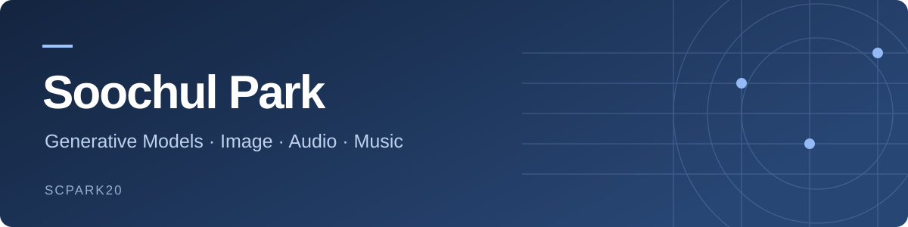
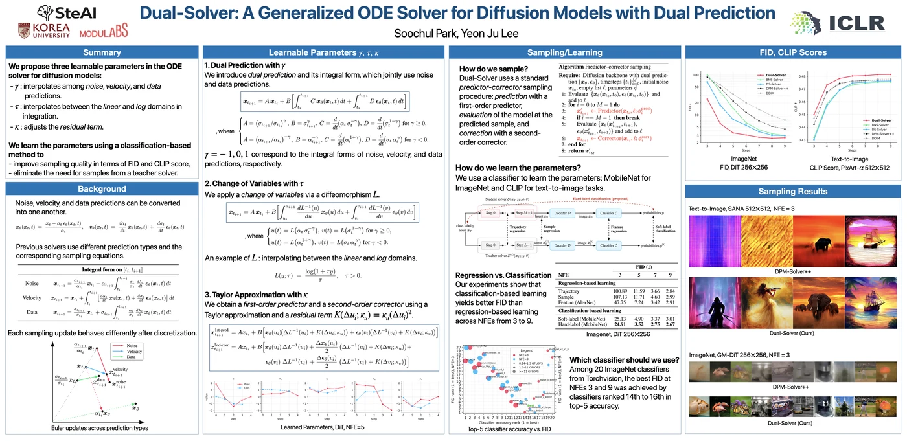
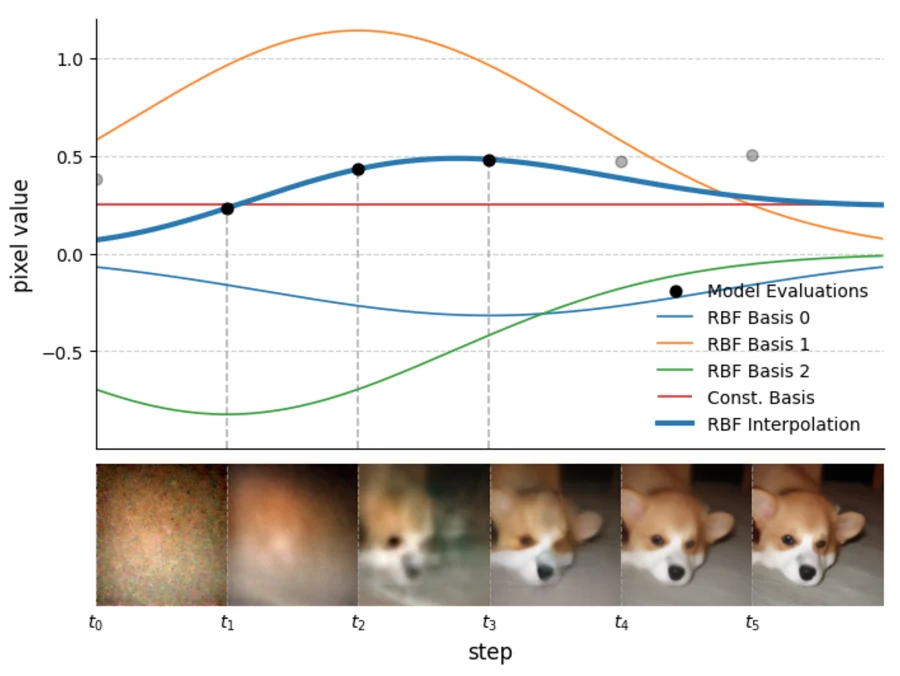
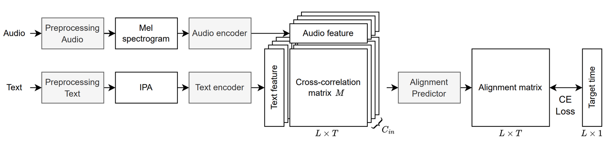
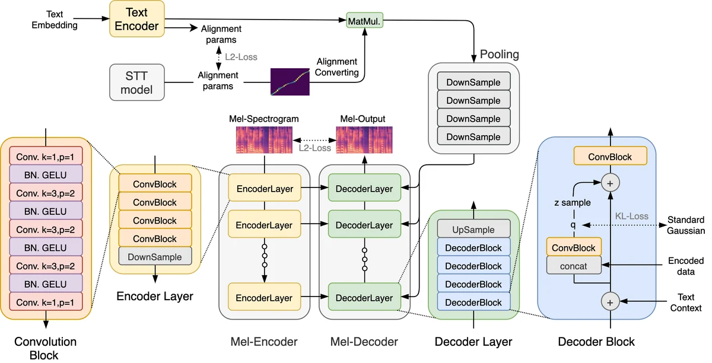
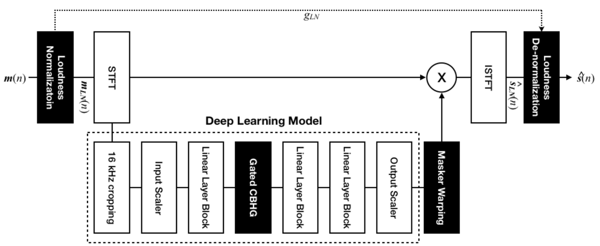
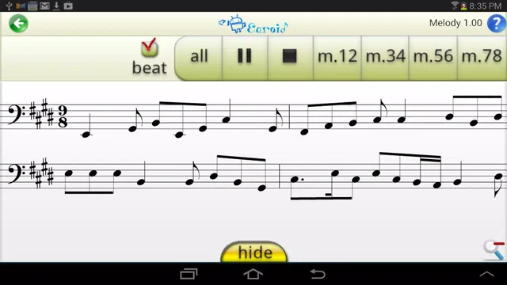
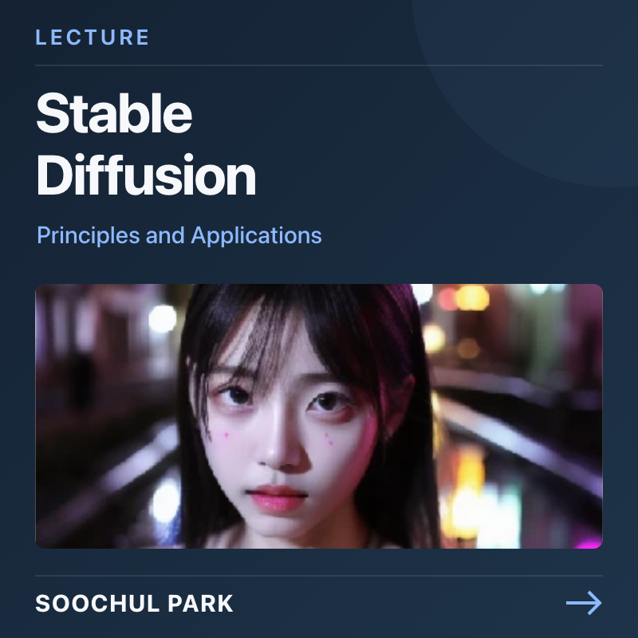
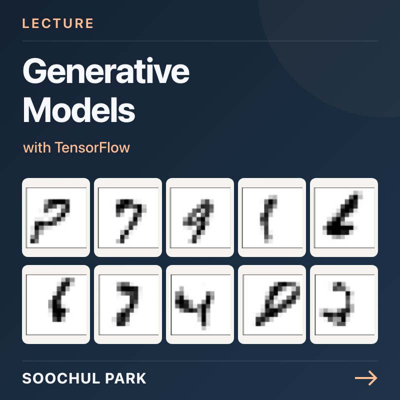
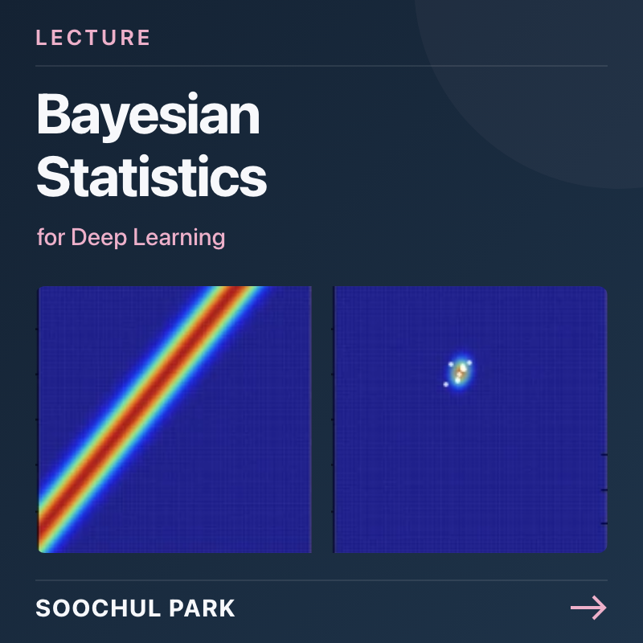

I am an independent researcher working on diffusion sampling and generative models for images and audio. I also lead [**logp(x)**](https://modulabs.co.kr/labs/265) at MODULABS, where we study the core principles of generative models.

  
  
  
  

## Papers

<table>
<tr>
<td width="50%" valign="top">

<strong>ICLR 2026</strong>

<h3><a href="https://arxiv.org/abs/2603.03973">Dual-Solver</a></h3>

A Generalized ODE Solver for Diffusion Models with Dual Prediction

</td>
<td width="50%" valign="top">

<strong>2026 · Preprint</strong>

<h3><a href="https://arxiv.org/abs/2603.13330">RBF-Solver</a></h3>

A Multistep Sampler for Diffusion Probabilistic Models via Radial Basis Functions

</td>
</tr>
<tr>
<td align="center"></td>
<td align="center"></td>
</tr>
<tr>
<td><a href="https://arxiv.org/abs/2603.03973"><strong>Paper</strong></a> · <a href="https://github.com/scpark20/Dual-Solver"><strong>Code</strong></a></td>
<td><a href="https://arxiv.org/abs/2603.13330"><strong>Paper</strong></a> · <a href="https://github.com/scpark20/RBF-Solver"><strong>Code</strong></a></td>
</tr>
</table>

<table>
<tr>
<td width="28%" align="center"></td>
<td><strong><a href="https://arxiv.org/abs/2307.04377">HCLAS-X</a> · 2023</strong> Hierarchical and Cascaded Lyrics Alignment System Using Multimodal Cross-Correlation Preprint</td>
</tr>
<tr>
<td align="center"></td>
<td><strong><a href="https://github.com/scpark20/KimchiSpeech/blob/gh-pages/kimchispeech.pdf">KimchiSpeech</a> · 2021</strong> Faster, Lighter and More Controllable TTS with Hierarchical VAE and STT-aided Gaussian Attention Preprint · <a href="https://scpark20.github.io/KimchiSpeech/">Audio samples</a></td>
</tr>
<tr>
<td align="center"></td>
<td><strong><a href="https://arxiv.org/abs/2010.12139">GSEP</a> · 2020</strong> A robust vocal and accompaniment separation system using gated CBHG module and loudness normalization Preprint</td>
</tr>
</table>

## Music & software

I studied Music Composition with a double major in Computer Science at Seoul National University. My graduation projects, the interactive music work [**WOBBLE**](https://soundcloud.com/hutenheum/wobble) and the ear-training application [**Earoid**](https://github.com/scpark20/earoid-app), brought together music and software.

<table>
<tr>
<td width="50%" align="center"></td>
<td width="50%" align="center"></td>
</tr>
<tr>
<td valign="top"><h3><a href="https://github.com/scpark20/Music-GPT-2">Music-GPT-2</a></h3>Music GPT-2 Implementation with Relative Positional Embedding
<a href="https://soundcloud.com/hutenheum/sets/three-musical-moments-by-gpt-2"><strong>Listen to Three Musical Moments</strong></a>
</td>
<td valign="top"><h3><a href="https://github.com/scpark20/earoid-app">Earoid</a></h3>Ear-training Android app
Computer Science capstone project
</td>
</tr>
</table>

[**Universal Music Translation**](https://github.com/scpark20/universal-music-translation) — A Universal Music Translation Network Implementation

## Teaching

<table>
<tr>
<td width="33%"></td>
<td width="33%"></td>
<td width="33%"></td>
</tr>
<tr>
<td valign="top"><strong><a href="https://github.com/scpark20/learning_stable_diffusion">Principles and Applications of Stable Diffusion</a></strong></td>
<td valign="top"><strong><a href="https://github.com/scpark20/DGM-it">Generative Models with TensorFlow</a></strong></td>
<td valign="top"><strong><a href="https://github.com/scpark20/deeplearning-espresso">Bayesian Statistics for Deep Learning</a></strong></td>
</tr>
</table>

[**AI Specialist Program**](https://github.com/scpark20/aiffel_2022) · [**AI for Music**](https://github.com/scpark20/AI-for-Music) · [**AI Training for IT Developers**](https://github.com/scpark20/AI-lectures) · [**Deep Learning for Audio Processing**](https://github.com/scpark20/audio-preprocessing-practice)

### The Hitchhiker’s Guide to Deep Learning

[**YouTube · @deep_hitch**](https://www.youtube.com/@deep_hitch) — [Flow Matching](https://www.youtube.com/watch?v=YFZbFr3cjpA) · [ELBO](https://www.youtube.com/watch?v=wBBR18RtLxQ) · [Diffusion](https://www.youtube.com/watch?v=P-gqrYYZ3a8) · [KL-Divergence](https://www.youtube.com/watch?v=Ymehhn427EY)

<strong>Research & industry background</strong>

My earlier research spans music and speech. At GAUDIOLAB, I worked on [**GTS**](https://www.gaudiolab.com/products/ai-text-sync) for music–lyrics synchronization, and at VIVESTUDIOS, on **VSpeech**, an integrated TTS and voice conversion model. Earlier, I developed source separation and **FOLLE** sound generation models at GAUDIOLAB, and singing assessment and personalized TTS at SM Entertainment. Related papers include [**HCLAS-X**](https://arxiv.org/abs/2307.04377) for lyrics alignment, [**KimchiSpeech**](https://github.com/scpark20/KimchiSpeech/blob/gh-pages/kimchispeech.pdf) for speech synthesis, and [**GSEP**](https://arxiv.org/abs/2010.12139) for source separation. I am also a co-inventor on patents concerning speech generation, voice extraction and audio signal processing.

---

[**Full profile**](https://scpark20.github.io/) · [Experience](https://scpark20.github.io/#experience) · [Patents](https://scpark20.github.io/#patents) · [Awards & Certifications](https://scpark20.github.io/#honors) · [Talks](https://scpark20.github.io/#talks) · [Community](https://scpark20.github.io/#community)
